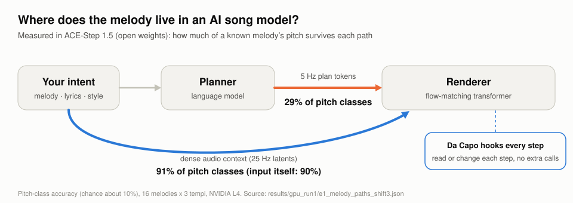
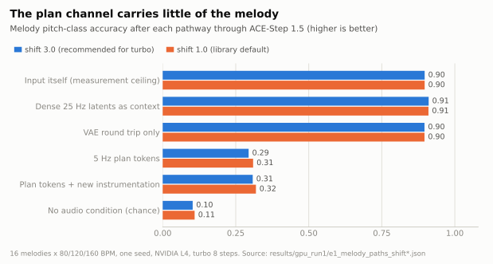
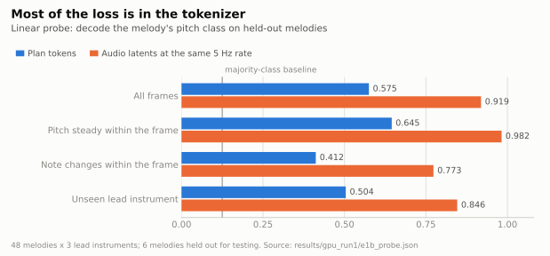
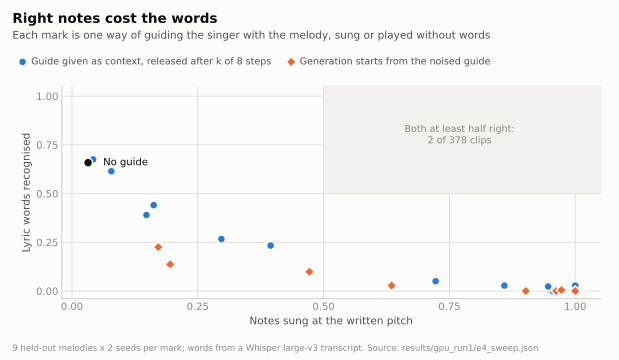
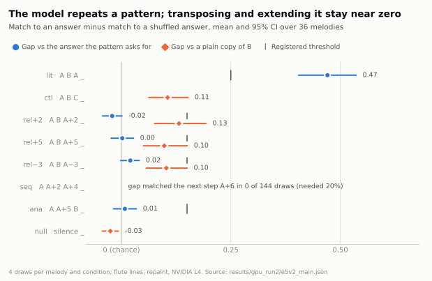
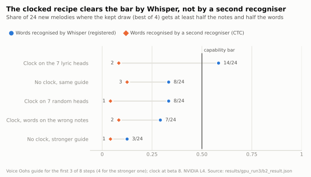
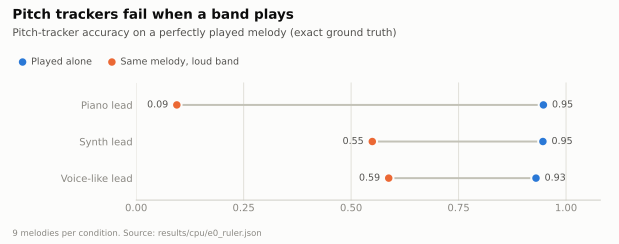

# Da Capo

[](https://colab.research.google.com/github/ninondev/DaCapo/blob/main/notebook.ipynb)

[English](README.md) | 中文

<picture>
  <source media="(prefers-color-scheme: dark)" srcset="figures/hero_dark.svg">
  
</picture>

我小学学了五年音乐，业余考级考到六七级（满级十级），上初中就没再碰了。后来是 AI 写歌让我又对音乐有了兴趣。我想让 AI 唱我自己写的旋律，结果歌是好听的，旋律却不是我的；想让副歌在后面再出现一次，它基本做不到。

这个仓库就是我在找原因。这里研究一个开源模型 ACE-Step 1.5，测旋律在它里面是在哪一步丢掉的。

## 谁做了什么

- 我：定了要找的问题；在 Colab 上跑 GPU 测试；决定把测试搬到 GPU 上，决定在渲染器里控制旋律；要求每个主要研究先写好规则再跑，最后的结论要用真人盲听。
- 另一个 AI：建议用 ACE-Step 1.5，给了整体计划。
- 写代码的代理：设计具体测法，写代码，跑 CPU 上的测试，算结果，写这份说明和日志。

## 模型是怎么工作的

[ACE-Step 1.5](https://github.com/ace-step/ACE-Step-1.5)（MIT 许可）分两部分。一个语言模型（规划器）先把歌写成一份粗略的规划，形式是 token，每秒 5 个。一个流匹配模型（渲染器）再根据这份规划、歌词和一句文字描述，用 8 个去噪步生成音频。渲染器也可以不用规划，直接拿一段真实音频当稠密上下文。

给旋律打分用的是音级准确率：音名（C、D、E 这些，不管八度）和乐谱对得上的时间占多少。

## 测出了什么

1. 规划会丢掉大部分旋律。经过 5 Hz 规划 token 之后，只有 29% 的帧音名是对的，瞎猜大约是 10%。这还是 token 直接从这段旋律自己的音频算出来的情况，对规划器来说已经很容易了。同一段旋律直接作为稠密音频交给渲染器，得分是 91%，和原音频（90%）一样。
2. 很大一部分丢失发生在 token 化这一步。用一个线性探针，从同样每秒 5 帧的音频潜变量里读音名，准确率是 0.919；从规划 token 里读，只有 0.575。不过 0.575 还是比渲染器用这些 token 唱出来的 29% 高，所以渲染器使用 token 的时候也丢了一些。
3. 在这些测试里，模型要么唱对歌词，要么唱对旋律，两样不能都对。只给歌词不给旋律，它能唱出 66% 的词。用一段没有歌词的旋律去引导它，音唱准了（86% 到 100%），歌词却掉到 3% 或更少。后来加上歌词时钟的测试，按 Whisper 的计数好了不少（见“结果”），但换第二个识别器来听，没有证实这些词。

所以我决定把控制放在渲染器里，因为旋律在那里还在。代码能看到 8 个去噪步中的每一步，可以读取或修改模型正在生成的东西，也可以换掉它听的文字、歌词或音频，而且不多调用一次模型。

## 结果

这里每个数字都来自 [`results/`](results/) 里的文件，每张图都由 [`figures/make_figures.py`](figures/make_figures.py) 从这些文件画出来。测试规模还小，每一节都写了样本量。

### 旋律在哪里丢失

<picture>
  <source media="(prefers-color-scheme: dark)" srcset="figures/e1_melody_paths_dark.svg">
  
</picture>

代理做了 16 条音符完全已知的旋律，每条是钢琴或长笛旋律，配和弦、贝斯和鼓，速度分别是 80、120、160 BPM。每条旋律都走一遍模型的每条路径，再测出来还剩多少旋律。

走稠密音频这条路，音名保留得和测量工具能测到的一样好。它的音符 F1 是 0.72，原音频是 0.78，差距和单纯把音频编码再解码一次差不多。走规划 token 就少多了。每个输出也和同速度的其他旋律比一次，扣掉这个随机水平之后，token 只保留了 28%（95% 置信区间 22% 到 34%）的旋律信息，音符 F1 只有 0.12。

<sub>16 条旋律 × 3 种速度，一个随机种子，NVIDIA L4，8 步 turbo 模型。shift 是采样器的一个设置：3.0 是 ACE-Step 文档给 turbo 推荐的值，默认值 1.0 结果一样。“无音频”这一项每种设置只有 6 个不同的生成结果。代理之前在 CPU 上做过一次更小的测试（每种速度 4 条旋律），90 BPM 时 token 得了 0.51，GPU 上没有重复出来，所以这里用 GPU 的数字。代码：[`experiments/e1_melody_paths`](experiments/e1_melody_paths/)。</sub>

### 为什么会丢失

<picture>
  <source media="(prefers-color-scheme: dark)" srcset="figures/e1b_probe_dark.svg">
  
</picture>

帧率低不是全部原因。一个音在整个 200 毫秒的帧里都没变时，探针从音频潜变量里几乎能全读对（0.982），从规划 token 里只有 0.645。分开读每个 token 里的编码数字会好一点（0.748）。token 还把乐器的音色混进了规划：按整段算，只换主奏乐器，变掉的 token 和换一条旋律差不多多（73% 对 71% 的帧）。同一段音频编码两次，本来就会变掉大约 15%。

<sub>48 条旋律 × 3 种主奏乐器。探针在 42 条旋律上学习，在另外 6 条上测试（720 帧，一次划分）。代码：[`experiments/e1_melody_paths`](experiments/e1_melody_paths/)。</sub>

### 歌词还是旋律

<picture>
  <source media="(prefers-color-scheme: dark)" srcset="figures/e4_tradeoff_dark.svg">
  
</picture>

代理让模型按一条旋律唱一句歌词，每个单音节的词对一个音。没有引导时它不知道旋律，所以音只是碰巧对上（3%），但能唱出 66% 的词。然后用这段旋律的无歌词版本引导它，有两种方式：在 8 步里的前 k 步当上下文，或者加噪后当生成的起点（SDEdit，一种已有的方法，这里拿来当基线）。凡是把音唱准的设置（86% 以上），歌词都没了（3% 或更少）。378 段测试音频里，只有 2 段音和词都对了一半以上。

目前的猜测是旋律和歌词得一起引导，一个音节一个音节地对上。这就是“歌词时钟”的想法，下面的 Run B 测了它。

<sub>12 条旋律（3 条用来试设置，9 条用来测试）× 21 种设置 × 2 个随机种子。歌词由 Whisper large-v3 转写。这个测试是探索性的：设置没有在测试前登记。代码：[`experiments/e4_sing`](experiments/e4_sing/)。</sub>

### 模型会不会发展一个动机

<picture>
  <source media="(prefers-color-scheme: dark)" srcset="figures/e5_motif_dark.svg">
  
</picture>

这是主要的研究（E5）。测试先放三段短旋律组成的模式，每段 4 秒，在 12 到 16 秒留一段空白，让模型用重绘（repaint）把它填上。A B A 之后，按模式应该接 B。每段空白的分数是：它的音和答案有多像，减去它和打乱后的答案有多像。打乱后的答案节奏一样，用的音也一样，所以 0 就是随机水平。假设和门槛写在[预注册文件](experiments/e5_motif/registration/prereg.json)里。第一次运行没过自己的质量检查（[`v1_outcome.json`](experiments/e5_motif/registration/v1_outcome.json)），所以这是第二次运行，开始前登记在 [addendum 2](experiments/e5_motif/registration/addendum_2.json) 里。第二次运行之前，测量工具的检查失败过一次。登记文件规定这时要重做旋律，所以我选了重做旋律，没有改检查方法（详情见 [`LOG.md`](LOG.md)）。

- 重复（H1，成立）：A B A 之后，空白对 B 的分数是 0.47（95% 置信区间 0.40 到 0.54）。登记的门槛是 0.25。
- 因为模式才重复（H2，成立）：A B C 之后，模式并不要求 B，空白对 B 的分数只有 0.11（0.06 到 0.15）。两者之差是 0.37（0.31 到 0.42），超过登记的 0.15。只看通过质量检查的空白，结论也一样（0.40，0.33 到 0.48）。所以模型重复 B，是因为模式要求它，而不只是因为 8 秒前放过 B。
- 移调（H3，不成立）：A B 之后接一个升高 2 个半音的 A，答案应该是同样升高 2 个半音的 B。空白和它对不上：升 2、升 5、降 3 个半音分别是 -0.02、0.00 和 0.02，要求是 0.15。它反而稍微更像没移调的 B（0.13、0.10 和 0.10）。
- 模进（H4，不成立）：A、A+2、A+4 之后，空白一次也没有填成下一步 A+6（144 次里 0 次，要求 20%）。
- 类比（H5，不成立）：A、A+5、B 之后，空白和 B+5 对不上：0.01（-0.02 到 0.03），要求是 0.15。

所以模型能接着它听到的模式往下走，办法是把其中一段原样重复，而重复哪一段由模式决定。移调、模进和类比都远没有达到登记的门槛。其中最大的一个效应，是降 3 个半音的移调和它的 A B C 对照相比，只有 0.03（0.005 到 0.05），而要求是 0.15。旋律都是没有人声的长笛旋律，用重绘填空，只测了一个模型。分数来自音高追踪器。关于听起来怎么样，要等真人盲听之后我才会下结论。

<sub>36 条新旋律 × 8 种条件 × 4 次抽样 = 1152 段空白，NVIDIA L4，提交 83d46e7。阶段 0b 先选了设置（重绘、长笛，112 段空白里 88 段通过，要求 84 段）。静音条件以外的 1008 段空白里，804 段通过了质量检查（要求 756 段）。按登记的规则，结论用全部抽样来定，置信区间来自对旋律的重抽样。代码：[`experiments/e5_motif`](experiments/e5_motif/)。</sub>

### 歌词注意力头跟不跟得上词

ACE-Step 1.5 用 7 个注意力头来判断每个歌词词在什么时候唱出来。读出（E6）要在歌词时钟用上它们之前，先检查它们是不是真的跟着词走。88 段无伴奏清唱里，76 段有歌声（要求 44 段），50 段能打分，也就是至少有 4 个词和 Whisper 对上（要求 20 段）。在一段典型的音频里，这些头给出的词的开始时间和 Whisper 差 0.21 秒（允许 0.25 秒）。随机挑的 7 个头的组合，中位数差 1.95 秒。50 段里有 49 段（98%，要求 75%），真正的头比典型的随机组合更准。所以按登记的规则，歌词时钟（B1）可以做。有两点要注意：在这些音频上，Whisper 和另一个对齐工具（MMS）彼此之间的中位数差就有 0.39 秒，所以 0.21 秒已经在参考答案本身的误差之内。另外，7 个头里有 6 个正好是单独最准的 6 个头，但第 7 个（第 3 层第 11 个头）单独用时差 2.41 秒。

这说明在生成好的音频里，这些头跟得上词的时间，但不说明它们能控制时间。B1 按它自己的规则测了这一点：在登记的强度下，时钟没有把时间对准（见下文）。ACE-Step 训练时可能就让这些头和歌词对齐过，所以赢过随机的头只是一个基本检查，不算发现。

<sub>88 段音频：E4 的 12 句歌词 × 4 个种子，加上 4 段主歌 × 2 种声音 × 5 个种子，8 步 turbo 模型，NVIDIA L4。参照是 Whisper large-v3 给出的词的时间。这次读出是探索性的，它的规则只决定 B1 做不做。代码：[`experiments/e6_clock`](experiments/e6_clock/)。</sub>

### 歌词时钟能不能让它把词唱在音上

<picture>
  <source media="(prefers-color-scheme: dark)" srcset="figures/b2_clock_dark.svg">
  
</picture>

歌词时钟的做法是：某个词的音在响的时候，把 7 个歌词注意力头给这个词的注意力分数（在 softmax 之前）加上一个固定的量（beta）。beta 是 8 的时候，一个头本来只分给某个词十分之一的注意力，现在几乎全给了它。Run B 测了时钟两次，每次的规则都在运行前登记好了。

只用时钟（B1）没有把时间对准。没有旋律引导时，模型会把这些歌词唱早：在一段典型的音频里，词比它的音早 3.6 秒开始。在登记的强度 beta 2 下，12 句歌词里只有 2 句的时间误差减少了 30% 以上，要求是 9 句。听得出的歌词比例和有歌声的音频比例都没有下降，换成随机的头也没有效果。更强的时钟（beta 4）让 6 句的时间误差减少了 30% 以上，但听得出的歌词从 0.59 降到 0.52，词的开始时间仍然比音早，中位数是 2.9 秒。那也不是登记的测试。

加上旋律引导（B2）时，先由登记好的代码在 E4 的 12 句歌词上跑一遍，从 20 种加时钟的做法里选出一个：用旋律的无歌词版本（Voice Oohs 音色）在 8 步里的前 3 步当上下文，再加上 beta 8 的时钟。然后这个做法在 24 句新歌词和新旋律上跑，每条 4 次，留下音和词合起来分数最高的那一次。结果 24 条旋律里有 14 条过关：留下的那一次至少一半的音是对的，Whisper 也按顺序认出了至少一半的词（要求 12 条）。同样的引导、不加时钟是 8 条。时钟加在随机的头上是 8 条，把每个词的时间窗口挪到错的音上是 7 条。按留下那一次的平均分数（时钟加在歌词注意力头上是 0.52，加在随机的头上是 0.35，窗口挪到错的音上是 0.39，不加时钟是 0.39），登记的标签把时钟的效果记为“跟头有关”和“跟时间有关”。标签不改变结论。

这个结果有这些限制：
- 规则要求：加时钟的做法过关的旋律比例，要比不加时钟的最好做法至少高 0.20（24 条里多 5 条），而且这个差距的 95% 置信区间（对旋律重抽样算出来的）下限要大于 0，才算时钟的功劳。差距是 0.25（多 6 条），但下限正好是 0。所以登记的结论是“达到了能力门槛，但不算时钟的功劳”。在规则之外，如果把每条旋律留下那一次的分数拿来平均，加了时钟更高：+0.13（95% 置信区间 0.06 到 0.20）。这个分数同样要算 Whisper 认出的词，也用了同一个四选一。
- 换第二个语音识别器（一个 wav2vec2 CTC 模型）来听同样留下的那几次，加时钟的 24 次里有 2 次过关，只用引导的有 3 次。在留下的这些次上，它给时钟的分数比只用引导还低一点（认出的词少 0.08）；把每种条件的 96 段全算上，两者差不多（0.18 和 0.16）。它对每种条件都认得很差（0.05 到 0.18），所以定不了结论，但也没有证实 Whisper 的结果。歌词这部分的结论只靠 Whisper。
- 留下的那一次，是按决定它过不过关的同一个分数从 4 次里挑出来的。这是登记的流程。如果只生成一次，加时钟的做法有 32% 的旋律过关（不加时钟是 14%）。
- 余量很小。14 条里有 2 条一个音的余地都没有：如果每段都少对一个音，就正好剩 12 条；少对两个音，就只剩 10 条。按更严的门槛（音和词都对四分之三），加时钟和只用引导都是 24 条里 2 条。
- 运行前的计时检查把运行时间高估了大约 6 倍，因为 Whisper 在检查用的几段音频上陷入了重复。于是登记的削减规则从选做法的阶段去掉了 k = 3 的单簧管引导（30 种做法只跑了 25 种），又从测试里去掉了不加引导的那一组，其实完整的设计也跑得完。不加引导的那一组只是参照，不是比较对象，所以没有哪个结论取决于它。

在我对歌词下任何结论之前，要请人盲听这 24 对音频（每对是同一条旋律加时钟和不加时钟各留下的一段），回答旋律对不对、歌词清不清楚。按 addendum 3，这个盲听是探索性的，不会改变登记的结论。

<sub>B1：12 句歌词 × 5 种条件 × 3 次抽样。B2：阶段 D 是 25 种做法 × 12 句 × 3 次；阶段 T 是 5 种条件 × 24 句新歌词 × 4 次，共 480 段，没有丢失。音准在分离出的人声上用音高追踪器打分（随机水平约 0.10）。歌词按顺序和 Whisper large-v3 的转写逐词对照，转写时不告诉 Whisper 歌词是什么。NVIDIA L4，提交 bd61a9f。规则：B1 在 [addendum 2](experiments/e5_motif/registration/addendum_2.json) 和 [B1 代码 addendum](experiments/e5_motif/registration/addendum_2_b1code.json) 里，B2 在 [addendum 3](experiments/e5_motif/registration/addendum_3.json) 里。代码：[`experiments/e6_clock`](experiments/e6_clock/)、[`experiments/e8_clock_sing`](experiments/e8_clock_sing/)。</sub>

### 测量本身就难

<picture>
  <source media="(prefers-color-scheme: dark)" srcset="figures/e0_ruler_dark.svg">
  
</picture>

测模型之前，代理先在每个音都已知的音频上测了测量工具。音高追踪器测独奏旋律很准，一加上响亮的伴奏就不行了。完整混音里的类人声旋律，错一两个音很难被发现（最好的 AUC 是 0.65 到 0.78）。所以有伴奏的时候，都和原音频上的同一个分数比；唱歌的部分，只给要求“无伴奏”的歌打分。

<sub>图里每种条件 9 条旋律；找错音的测试每种条件 6 条旋律。代码：[`experiments/e0_ruler`](experiments/e0_ruler/)。</sub>

## 现在在做的

钩子的代码在 [`dacapo/ace.py`](dacapo/ace.py)。在 8 个去噪步的每一步，它都能看到模型以为最后的音频会是什么样，实验可以读它、改它，或者在中途换掉文字、歌词或音频。钩子什么都不改时，输出和不加钩子完全一样（CPU 和 GPU 上差别都是 0.0），所以输出里的变化都来自钩子做的改动。

Run A 在 2026-10-28 跑完了，结果在上面。动机研究（E5）发现模型会原样重复模式里的一段，移调、模进和类比都没有达到登记的门槛。接下来是它后面的阶段：看模型的哪些层在做这个复制，以及把模型的注意力引向 B 能不能让它有意地复制。按登记文件的规定，这些阶段的设计会在运行前写进一份新的 addendum。

Run B 在 2026-10-30 跑完了，结果在上面。只用歌词时钟没有把时间对准（B1）。加上旋律引导以后，选出的做法按 Whisper 的计数达到了登记的门槛（B2），但不算时钟的功劳；换第二个识别器来听，歌词唱得清不清楚也没有得到证实。

Run C 是 B2 的重复实验，用 96 条新旋律，已经搭好并登记，等 GPU 来跑（[addendum 4](experiments/e5_motif/registration/addendum_4.json)，[`notebook_runC.ipynb`](notebook_runC.ipynb)）。旋律是 B2 的 4 倍，应该能定下时钟到底有没有用。

盲听测试用的是这两次运行的音频：Run A 的 60 段动机音频和 Run B 的 24 对歌唱音频，听的人不知道每段来自哪种条件。这是我要求的。在盲听做完之前，动机研究的结论只靠音高追踪器的分数，歌唱的结论靠音高追踪器和 Whisper。

## 进展

| | 问题 | 状态 |
|---|---|---|
| E0 | 测量工具准不准？ | 完成 |
| E1 | 旋律经过模型每条路径后还剩多少？ | GPU 上完成：16 条旋律 × 3 种速度，两种 shift |
| E1b | 规划 token 里有什么，丢失在哪里？ | GPU 上完成：48 条旋律，一次测试划分 |
| E2 | 能不能在每个去噪步加钩子而不改变输出？ | 完成：CPU 和 GPU 上输出完全一样 |
| E3 | 能不能不管什么乐器都从音频潜变量里读出音高？ | 探索性：新乐器上 0.88（瞎猜 0.03）；专门的子空间并不比完整潜变量好 |
| E4 | 能不能既唱准音又唱清楚词？ | 探索性：12 条旋律 × 21 种设置 × 2 个种子 |
| E5 | 能不能发展一个动机？ | 第二次运行在 GPU 上完成：会把模式里的一段原样重复（H1、H2 成立），但移调、模进和类比都没有达到登记的门槛（H3 到 H5 不成立）。第一次运行没过质量检查 |
| E6 | 歌词时钟能不能对准每个音节？ | 读出在 GPU 上完成：歌词注意力头给出的词的开始时间和 Whisper 的中位数差 0.21 秒。只用时钟（B1）不成立：12 句里只有 2 句的时间误差减少得够多，要求 9 句 |
| E7 | Suno 和 ACE-Step 能把你给的旋律唱得多准？ | 已经登记，等 Suno 生成的歌 |
| E8 | 加上旋律引导，歌词时钟能不能把新旋律唱准、把词唱得认得出来？（阶段 B2） | GPU 上完成：按 Whisper 算，24 条新旋律里有 14 条过关（要求 12 条），达到了能力门槛，但不算时钟的功劳（差距的置信区间下限是 0）；换第二个识别器，只有 2 条过关。下一步是盲听 |

[`LOG.md`](LOG.md)（英文）记下了每一次运行，包括失败和犯过的错。

## 测试的规矩

先在音符已知的音频上测测量工具，再测模型。主要的研究在运行前写好假设和停止规则（这是我要求的）；有改动就加新文件，不改旧文件。不好的结果也公开。每种方法都会给同样多的尝试次数，“多生成几次挑最好的”会作为基线。不用语言模型来判断音乐，最后的结论会用真人盲听（这也是我要求的）。仓库里每个数字都能查到对应的结果文件，音频可以用固定的随机种子由代码重新生成（同一台设备结果一样，CPU 和 GPU 之间可能不同）。

## 运行

最简单的是点上面的 Colab 按钮，选 L4，点“全部运行”，再允许一次 Google Drive 访问。笔记本会自动安装、下载 ACE-Step 的开源权重（约 10 GB），然后跑 Run A：修好后的动机研究和歌词读出。在 L4 上大约 4 小时，包括安装和下载。最后你会拿到一个结果压缩包，另有一个单独的文件，里面是盲听测试的答案。运行状态存在 Drive 上（约 5 GB；E5 开始前要求至少有 7.5 GB 空间），所以运行时重置后，再点一次“全部运行”就会从停下的地方接着跑。第一次 GPU 运行的那些测试，仍然可以用 `--stages` 来跑。Run B（歌词时钟）有自己的笔记本 [`notebook_runB.ipynb`](notebook_runB.ipynb)，在 L4 上各阶段大约用了 5 小时。想用 B2 的做法唱你自己的旋律，可以用 [`notebook_sing.ipynb`](notebook_sing.ipynb)：一个音唱一个词，加上歌词时钟，生成几次留下最好的一次。它是工具，不是研究，需要 L4 或 A100（[`experiments/sing`](experiments/sing/)）。

在自己电脑上跑测量工具（macOS 或 Linux）：

```bash
git clone https://github.com/ninondev/DaCapo && cd DaCapo
uv venv --python 3.12 && source .venv/bin/activate
uv pip install -e ".[dev,transcription]"
uv pip install --no-deps basic-pitch        # 用 ONNX 模型，不装 TensorFlow
# FluidSynth 和 General MIDI 音色库：
#   Ubuntu: sudo apt install fluidsynth fluid-soundfont-gm
#   macOS:  brew install fluid-synth，然后 export DACAPO_SF2=/path/to/FluidR3_GM.sf2
pytest -q -m "not slow"                      # 单元测试；直接 pytest -q 会连端到端测试一起跑
python experiments/e0_ruler/run.py --quick   # 测试测量工具（CPU 约 3 分钟）
python figures/make_figures.py               # 从 results/ 重新画所有图
```

运行歌曲模型的测试还需要装 [ACE-Step 1.5](https://github.com/ace-step/ACE-Step-1.5)。每一步的具体命令在 [`experiments/run_all.py`](experiments/run_all.py) 里。

<details>
<summary>文件</summary>

```
dacapo/           代码库：旋律、渲染、音高追踪、打分，还有 ace.py（接到 ACE-Step 上的钩子）
experiments/      每个研究一个文件夹（e0 到 e9），还有笔记本调用的 run_all.py、run_b.py 和 run_c.py
results/cpu/      CPU 上跑出来的结果文件
results/gpu_run1/ 第一次 GPU 运行（NVIDIA L4）的结果文件
results/gpu_run2/ Run A 的结果文件：动机研究和歌词读出（NVIDIA L4）
results/gpu_run3/ Run B 的结果文件：只用歌词时钟（B1）和时钟加旋律引导（B2）（NVIDIA L4）
figures/          图和画图的脚本
tests/            单元测试和“渲染到分析”的测试
LOG.md            按时间记下的每次运行
notebook.ipynb    Run A 的 Colab 笔记本
notebook_runB.ipynb Run B 的 Colab 笔记本
notebook_sing.ipynb 工具：用 B2 的做法唱你自己的旋律
notebook_runC.ipynb Run C 的 Colab 笔记本
```

</details>

## 计划

- [x] 在音符已知的音频上测试测量工具
- [x] 找到旋律在开源歌曲模型里丢失的位置
- [x] 每个去噪步的钩子，在 CPU 和 GPU 上确认完全准确
- [x] 摸清音准和歌词之间的取舍（探索性）
- [x] 动机研究：修好后的运行，开始前先登记
- [x] 在 GPU 上跑修好后的动机研究和歌词读出（Run A）
- [ ] 用 Run A 的动机音频做盲听测试
- [ ] 动机研究的后续阶段：哪些层在做复制（先写新的 addendum）
- [x] 在 GPU 上跑 Run B：只用歌词时钟（B1），以及时钟加旋律引导（B2）
- [ ] 用 Run B 的 24 对歌唱音频做盲听测试
- [ ] Run C：在 96 条新旋律上重做 B2 的两种做法（已经登记，等 GPU）
- [ ] 用同样的 12 条旋律测 Suno 和 ACE-Step（E7，阶段 S）
- [ ] 在渲染器里训练一个旋律适配器（E7），除非阶段 S 显示这件事已经有人做好了
- [ ] 用更多随机种子重复，再请音乐人做盲听测试
- [ ] arXiv 论文和带音频的演示页

## 致谢和许可

这个项目研究的是 [ACE-Step 1.5](https://github.com/ace-step/ACE-Step-1.5)，用到了 [SwiftF0](https://pypi.org/project/swift-f0/)、[FCPE](https://pypi.org/project/torchfcpe/)、[CREPE](https://github.com/maxrmorrison/torchcrepe)、[Basic Pitch](https://github.com/spotify/basic-pitch)、[Whisper](https://github.com/openai/whisper)、[mir_eval](https://github.com/craffel/mir_eval)、[FluidSynth](https://www.fluidsynth.org/) 和 FluidR3_GM 音色库。谢谢所有公开模型和工具的人。

引用格式：

```bibtex
@misc{dacapo2026,
  title  = {Da Capo: Measuring and Steering Musical Structure in AI Song Models},
  author = {ninondev},
  year   = {2026},
  url    = {https://github.com/ninondev/DaCapo}
}
```

MIT 许可，© 2026 ninondev（[LICENSE](LICENSE)）。
